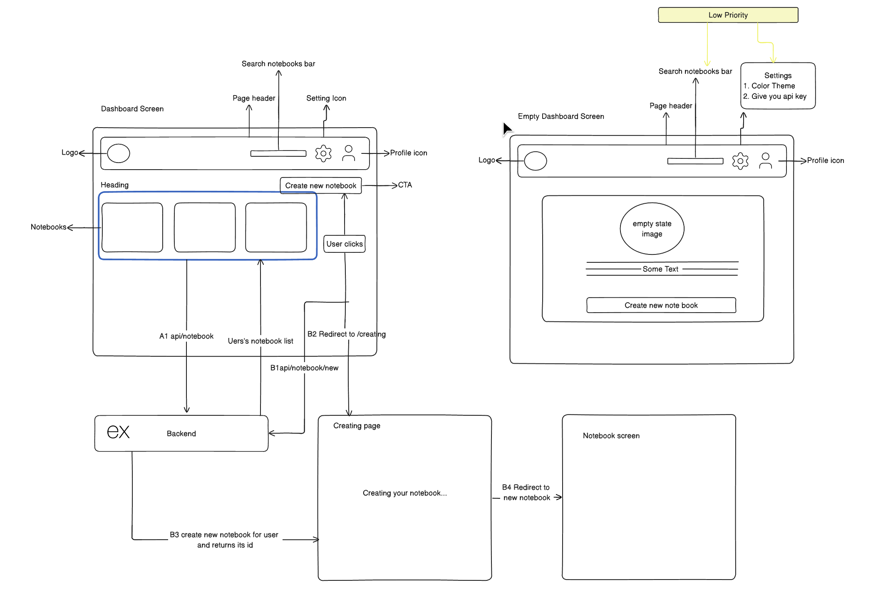

# Dashboard Screen Architecture Plan
This docs define the higher level design plan for the dashboard screen.

## Architecture Image

## Plan
1. Dashboard screen will have a page header, with Logo on left and search, setting icon and profile icon on right.
2. Search and setting both options are low priority
3. After header there is notebook list component and a create new cta.
4. For new user instead of list we are going to show empty state with a create new notebook cta.
5. To get the list of notebooks we are gonna call `api/notebooks`
6. All the notebook cards have a more options cta which edit title, pin to top, add to collection and delete, in MVP we are going a head only with edit and delete. All the get notebooks, get notebook, edit and delete gonna be simple REST API calls.
7. Edit title gonna open a modal which give option to edit title, similarly delete opens a confirmation modal.
8. For create new notebook CTA, the api call to `api/notebook/new` should be made and a /notebook/creating route should be opened on FE, api should create a new notebook on DB and return success with id, then fe will update the url to notebook/[notebookId] which should show the notebook page.  