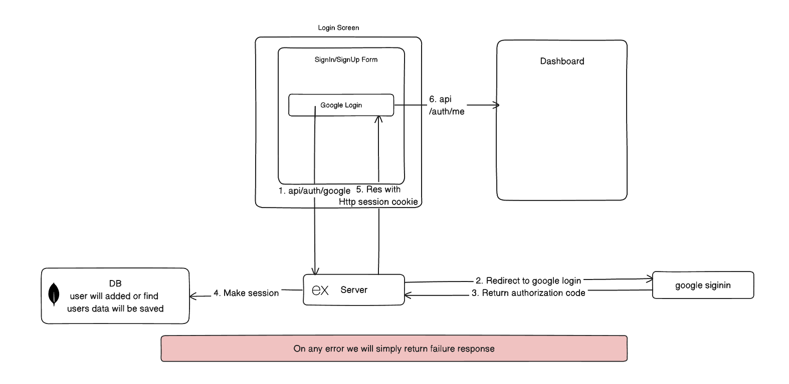

# Login Screen Architecture Plan
This docs define the higher level design plan for the login screen.

## Architecture Image

## Plan
1. This screen which give and option to user to signin with google.
2. All the google authorization stuff will be managed on the backend of the application.
3. On click on signin  with google the request will be sent to the `api/auth/google` route of the application backend.
4. The server will redirect the user on the google Sign in and the google signin screen will manage the login and will return the authorization code to the Backend server.
5. Backend server will find/create a user in case user  and create a session, store it in the DB and return the success response to user with http session cookie  
6. I am choosing backend initiated OAuth flow because later we also wanna drive support in the sources will be easier to handle with backend oAuth initiation.
7. Then FE can call `api/auth/me` to fetch and store user information to show in profile section.
8. And a `api/auth/logout` route, which will expired the session in the db, remove the session cookie and on success response frontend will also clear the data on it's side.
9. Take care of csrf in both Frontend -> Backend communication and Backend -> google oAuth communication.

